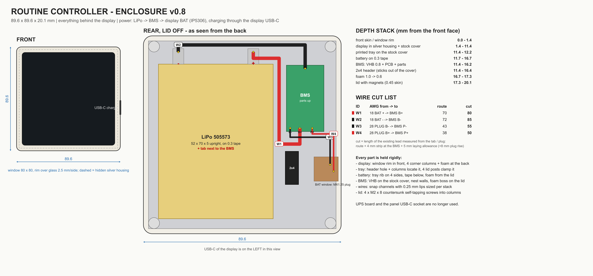

# Routine Controller enclosure v0.8

A compact wall-mounted enclosure for the **Guition ESP32-S3-4848S040** 4-inch 480×480 touch display, with a built-in LiPo battery and a magnetic wall dock. Every module sits behind the display, so the case is only **89.6 × 89.6 × 20.1 mm**.

[Українська версія](README.uk.md)


> **Status: prototype.** The geometry passes the collision, clearance and mesh checks in CAD, but v0.8 has not been confirmed by a full physical build yet. Print `fit-coupon.stl` and `rear-tray.stl` first (see [Assembly](#assembly)).

## Printable parts

All files are in [`cad/output`](cad/output). PETG or ASA, 0.16–0.20 mm layers, 4 perimeters, no scaling. The full set takes about 57 g of filament (61 g with the test coupon).

| File | What it is | Orientation |
|---|---|---|
| `front-tub.stl` | Main body with the display window | face down, no supports |
| `rear-tray.stl` | Spacer that holds the battery, BMS and wires | floor down |
| `rear-lid.stl` | Back lid with magnet pockets | already flipped, outer side down |
| `wall-dock.stl` | Wall plate with rails for four M4 washers | as exported; pause at about 1.9 mm to drop in the washers |
| `fit-coupon.stl` | Quick test frame for the display fit | as exported |

Mesh check (`cad/output/mesh-validation.json`): zero degenerate triangles, open edges or non-manifold edges in every part.

## Power

The display board already has an **IP5306** charger/boost chip next to its **BAT** socket. It charges a single-cell LiPo from the display's own USB-C port and boosts it to 5 V, so no extra UPS board is needed:

```text
LiPo 505573 ─ 18 AWG ─ BMS HXYP-1S-30T8 ─ MX1.25 2P plug ─ display BAT socket
charging: the display's own USB-C (opening in the left wall, seen from the back)
```

Polarity is printed on the board (B+ and B−). Always check it on the plug with a multimeter before connecting.

## Bill of materials

See [`BOM.csv`](BOM.csv). In short: the display, a 505573 LiPo (52 × 70 × 5 mm), an HXYP-1S-30T8 BMS, an MX1.25 2P pigtail, four 30 × 10 × 2 mm N38 magnets, four M2 × 8 countersunk self-tapping screws, four DIN 125 M4 washers, 1 mm foam, 0.3 mm foam tape and a piece of VHB.

## Why the stock rear cover stays

The tallest parts on the board (MX1.25 sockets, the ESP32-S3 module, USB-C) rise about 3.5 mm, and the stock rear cover sits about 4 mm above the board. Removing it would not make the case thinner, while keeping it holds the board the way the manufacturer intended. The printed `rear-tray.stl` rests on that cover.


## Layout (rear view, mm from the lower-left display corner)

| Part | Position | Held by |
|---|---|---|
| 2×4 pin header (sticks out 5 mm) | x 62–68, y 20–35 | passes through the tray hole and locates it |
| Battery 52 × 70 × 5, upright | x 4.5–56.5, y 4.5–74.5; tabs up | tray ribs on 4 sides, 0.3 mm foam below, 1 mm foam from the lid |
| BMS 17 × 30 × 4, parts up | x 62.5–79.5, y 44–74; P−, B+, P+ at the bottom, B− at the top | VHB to the stock cover, header walls, foam boss on the lid |
| MX1.25 plug in the BAT socket | tray window x 75–85, y 21.5–32.5 | wires pressed into the channel |
| Display USB-C (charging) | left wall, 50 mm from the top, 7.5 mm from the glass | 12.6 × 7 mm opening |

The battery's positive tab should face the BMS. If yours is the other way round, flip the battery.

## Depth stack (mm from the front)

Front skin 1.4 → display with stock cover 10 (to 11.4) → foam 0.3 → battery 5 (to 16.7) → foam 0.6 → lid with magnets 2.8 = **20.1 mm**.

## Wires

Cut with spare length: route + 4 mm stripped at the BMS + 5 mm slack (+8 mm so the plug can drop into the socket).

| ID | AWG | From → to | Route | Cut length |
|---|---:|---|---:|---:|
| W1 red | 18 | battery + → BMS B+ | 70 | **80** |
| W2 black | 18 | battery − → BMS B− | 72 | **85** |
| W3 | 28 | BAT plug, B− pin (upper) → BMS P− | 43 | **55** |
| W4 | 28 | BAT plug, B+ pin (lower) → BMS P+ | 38 | **50** |

Ready-made MX1.25 pigtails come in any colour. Check which lead goes to which pin before soldering.



## Assembly

1. Print `fit-coupon.stl` and `rear-tray.stl`. Check that no silver edge of the display shows, that the tray sits on the stock cover, and that its holes line up with the 2×4 header and the BAT socket.
2. Solder battery, BMS and plug according to the wire table. Check polarity on the plug with a multimeter.
3. Place the display face down in the body and stick 1 mm foam pads on the corners of its rear cover.
4. Lay in the tray, stick the BMS on with VHB and the battery on thin foam, press the wires into the channels.
5. Plug into the BAT socket. The display should turn on, and USB-C should charge the battery.
6. Stick 1 mm foam on the lid (over the battery, on the BMS boss and on the 4 posts), glue in the magnets and drive in the 4 screws.

## Things to check on real parts

- **Stock cover:** the model assumes a flat cover flush with the back edge of the display housing (10 mm total). The tray test print will show this.
- **Wi-Fi:** the display antenna is glued to the inside of the top edge, and the battery passes about 10 mm from it. Check signal strength before final assembly.
- **IP5306 auto-off:** it cuts the output under very light load (roughly below 45–50 mA for 30 s). With the screen on this does not matter, but deep sleep on battery will not work: the board just turns off.
- **Charge current:** the MX1.25 connector is rated around 1 A. Measure the charging current with a USB tester.

## Rebuilding the model

The enclosure is fully parametric. All measurements and clearances are in the `P` dictionary at the top of [`cad/enclosure.py`](cad/enclosure.py).

```bash
pip install -r requirements.txt
python cad/enclosure.py       # geometry, collision and clearance checks, wire lengths, STL
python cad/validate_stl.py    # watertightness of the printable STL files
python cad/render_preview.py  # preview images and sections
python cad/drawing.py         # engineering-drawing.svg
npm install sharp && node cad/render_drawing.mjs   # optional PNG of the drawing
```

`enclosure.py` stops with an error if parts intersect, a wire touches the body, tray or lid, or any checked clearance drops below its minimum. Results go to `cad/output/build-report.json`.

## License

This design, including the STL files, CAD scripts, drawings and documentation, is licensed under [Creative Commons Attribution-NonCommercial-ShareAlike 4.0 International](https://creativecommons.org/licenses/by-nc-sa/4.0/) (CC BY-NC-SA 4.0). See [`LICENSE`](LICENSE).

You may print, modify and share it for non-commercial purposes, with attribution, and under the same license. Selling the files, printed parts or products based on this design requires written permission from the author.

Guition and ESP32 are trademarks of their respective owners. This project is not affiliated with them.
