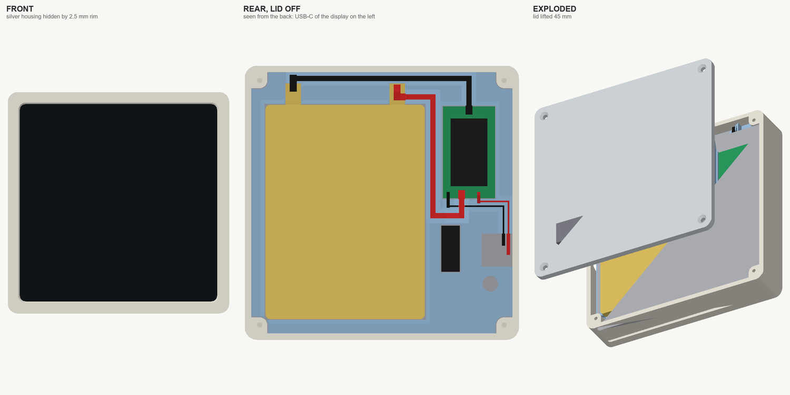
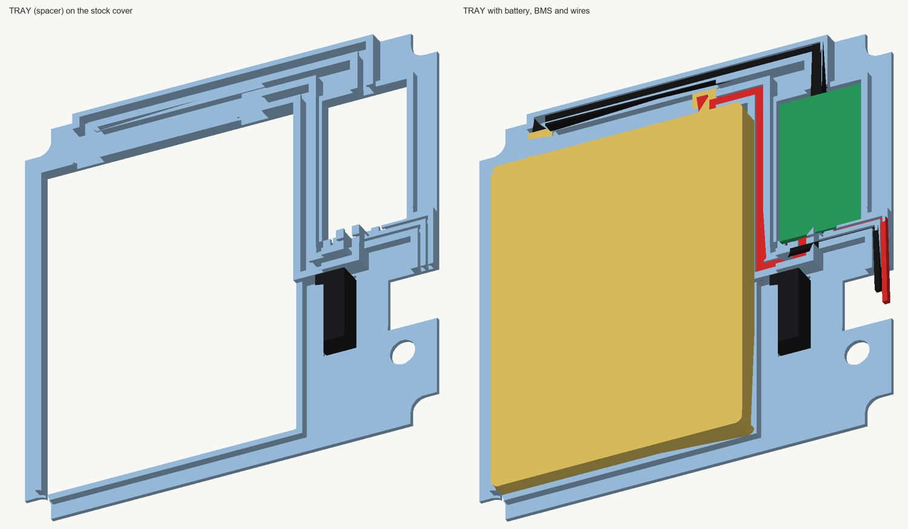

# Корпус Routine Controller v0.8

Компактний настінний корпус для сенсорного екрана **Guition ESP32-S3-4848S040** (4 дюйми, 480 × 480) з вбудованим LiPo‑акумулятором і магнітною настінною док‑станцією. Усі модулі сховані за екраном, тому корпус має розмір лише **89,6 × 89,6 × 20,1 мм**.

[English version](README.md)

> **Статус: прототип.** Геометрія проходить перевірки колізій, зазорів і сітки в CAD, але повне складання v0.8 наживо ще не підтверджене. Спершу надрукуйте `fit-coupon.stl` і `rear-tray.stl` (див. «Порядок складання»).



## Живлення

На платі екрана поруч із розʼємом **BAT** стоїть мікросхема **IP5306**. Вона заряджає однобанковий LiPo від USB‑C екрана і підвищує напругу до 5 В для плати. Полярність підписана на платі: B+ і B−. Тому схема коротка:

```text
LiPo 505573 ─ 18 AWG ─ BMS HXYP‑1S‑30T8 ─ вилка MX1.25 2P ─ розʼєм BAT екрана
заряджання: штатний USB‑C екрана (отвір у лівій стінці, якщо дивитися ззаду)
```

Окрема UPS‑плата, врізні гнізда USB‑C і вилка XN005 не потрібні.

## Чому штатна кришка екрана залишається

Найвищі деталі плати (розʼєми MX1.25, модуль ESP32‑S3, USB‑C) піднімаються приблизно на 3,5 мм, а площина штатної кришки лежить приблизно на 4 мм вище плати. Акумулятор однаково не опуститься нижче цього рівня, тож без кришки корпус тоншим не стане. Натомість кришка й далі притискає плату так, як задумав виробник. Роль прокладки виконує друкована деталь `rear-tray.stl`, яка лягає на кришку.



## Компонування (вигляд ззаду, мм від лівого нижнього кута екрана)

| Деталь | Положення | Чим тримається |
|---|---|---|
| Гніздо 2×4 (виступає на 5 мм) | x 62–68, y 20–35 | проходить крізь отвір прокладки і фіксує її |
| Акумулятор 52 × 70 × 5, стоїть вертикально | x 4,5–56,5, y 4,5–74,5; виводи вгору | бортик прокладки з 4 боків, піна 0,3 мм знизу, піна 1 мм від кришки |
| BMS 17 × 30 × 4, компонентами вгору | x 62,5–79,5, y 44–74; виводи P−, B+, P+ знизу, B− зверху | VHB на штатну кришку, стінки гнізда, бобишка з піною на кришці |
| Вилка MX1.25 у розʼємі BAT | вікно в прокладці x 75–85, y 21,5–32,5 | дроти втиснуті в канал |
| USB‑C екрана (заряджання) | ліва стінка, 50 мм від верху, 7,5 мм від скла | отвір 12,6 × 7 мм |

Плюсовий вивід акумулятора має дивитися в бік BMS. Якщо виводи розташовані навпаки, переверніть акумулятор іншим боком.

## Глибина (мм від лицьового боку)

Лицьова рамка 1,4 → екран із кришкою 10 (до 11,4) → піна 0,3 → акумулятор 5 (до 16,7) → піна 0,6 → кришка корпусу з магнітами 2,8 = **20,1 мм**. Гніздо 2×4 закінчується на 16,4, BMS на 16,2, найвищий дріт на 15,4.

## Як закріплена кожна деталь

- **Екран:** рамка вікна спереду перекриває скло на 2,5 мм з кожного боку, тому сріблястого корпусу не видно. Ззаду екран притискають 4 кутові колонки через піну 1 мм.
- **Прокладка:** по X/Y її фіксують отвір під гніздо 2×4 і вирізи під колонки, зверху притискають 4 упори кришки через піну.
- **Акумулятор і BMS:** див. таблицю вище.
- **Дроти:** канали з губками 0,25 мм під 18 AWG (2,2 мм) і 28 AWG (1,0 мм). Там, де W1 перетинається з W3, канал зроблено у два поверхи.
- **Кришка:** 4 саморізи M2 × 8 з потайною головкою в кутові колонки; по периметру бортик, який заходить усередину корпусу.

## Дроти

Відрізайте із запасом від виводу акумулятора або від вилки: траса + 4 мм на зачищення біля BMS + 5 мм на укладання (+8 мм, щоб вилка опустилася в розʼєм).

| ID | AWG | Звідки → куди | Траса | Довжина від виводу/вилки |
|---|---:|---|---:|---:|
| W1 червоний | 18 | акумулятор + → BMS B+ | 70 | **80** |
| W2 чорний | 18 | акумулятор − → BMS B− | 72 | **85** |
| W3 | 28 | вилка BAT, контакт B− (верхній) → BMS P− | 43 | **55** |
| W4 | 28 | вилка BAT, контакт B+ (нижній) → BMS P+ | 38 | **50** |

Кольори дротів у готових вилок MX1.25 бувають будь‑які. Перед паянням продзвоніть, який дріт приходить на який контакт. Якщо обидва виводи акумулятора мають червоні дроти, мінусовий краще замінити чорним або позначити.

## Порядок складання

1. Надрукувати `fit-coupon.stl` і `rear-tray.stl`, це швидко. Перевірити, що сріблястого краю не видно, а прокладка сідає на штатну кришку, отвір збігається з гніздом 2×4, а вікно з розʼємом BAT.
2. Спаяти акумулятор, BMS і вилку за таблицею, перевірити полярність на вилці мультиметром.
3. Покласти екран лицем донизу в корпус, наклеїти на кути кришки екрана шматочки піни 1 мм.
4. Укласти прокладку, приклеїти BMS на VHB, акумулятор на тонку піну, втиснути дроти в канали.
5. Вставити вилку в розʼєм BAT. Екран має увімкнутися, а заряджання через USB‑C має працювати.
6. Приклеїти піну 1 мм на кришку (над акумулятором, на бобишку BMS і на 4 упори), вклеїти магніти й закрутити 4 гвинти.

## Друк

Усі файли лежать у `cad/output`. PETG/ASA, шар 0,16–0,20 мм, 4 периметри, без масштабування.

- `front-tub.stl`: лицем на стіл, без підтримок.
- `rear-tray.stl`: дном на стіл.
- `rear-lid.stl`: уже розвернута зовнішнім боком на стіл.
- `wall-dock.stl`: рейки під шайби на стіні; пауза приблизно на 1,9 мм, щоб вкласти шайби. `fit-coupon.stl`: пробна рамка.

## Що перевірити на реальних деталях

- **Кришка екрана:** модель вважає, що штатна кришка пласка і її поверхня збігається із заднім краєм корпусу (загальна товщина 10 мм). Пробний друк прокладки це покаже.
- **Wi‑Fi:** антена екрана приклеєна до внутрішнього боку верхньої грані корпусу, а верхній край акумулятора проходить приблизно за 10 мм від неї. Перевірте рівень сигналу до остаточного складання.
- **IP5306 вимикає вихід за малого навантаження** (приблизно менше 45–50 мА довше 30 с). З увімкненим екраном це не заважає, але глибокий сон від акумулятора працювати не буде: плата просто вимкнеться. Час роботи від одного заряду з увімкненим екраном потрібно виміряти.
- **Струм заряджання:** розʼєм MX1.25 розрахований приблизно на 1 А. Перевірте USB‑тестером, скільки екран споживає під час заряджання.

## Матеріали

Перелік деталей у [`BOM.csv`](BOM.csv).

## Перезбирання моделі

Корпус повністю параметричний: усі розміри й зазори зібрані у словнику `P` на початку [`cad/enclosure.py`](cad/enclosure.py).

```bash
pip install -r requirements.txt
python cad/enclosure.py       # геометрія, перевірки колізій, довжини дротів, STL
python cad/validate_stl.py    # замкненість друкованих STL
python cad/render_preview.py  # превʼю і розрізи
python cad/drawing.py         # engineering-drawing.svg
npm install sharp && node cad/render_drawing.mjs   # PNG креслення, за бажанням
```

`enclosure.py` завершується помилкою, якщо деталі перетинаються, дріт зачіпає корпус, прокладку або кришку, або один із контрольних зазорів менший за мінімум. Усі результати записуються в `cad/output/build-report.json`.

## Ліцензія

Модель, включно з STL, CAD‑скриптами, кресленнями й документацією, поширюється за ліцензією [Creative Commons Attribution-NonCommercial-ShareAlike 4.0 International](https://creativecommons.org/licenses/by-nc-sa/4.0/deed.uk) (CC BY-NC-SA 4.0), повний текст у [`LICENSE`](LICENSE).

Модель можна друкувати, змінювати й поширювати з некомерційною метою, із зазначенням автора і за тією самою ліцензією. Продаж файлів, надрукованих деталей або виробів на основі цієї моделі можливий лише з письмового дозволу автора.
